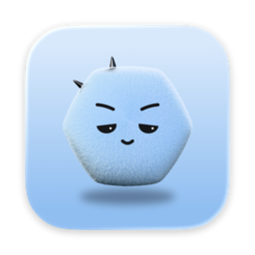
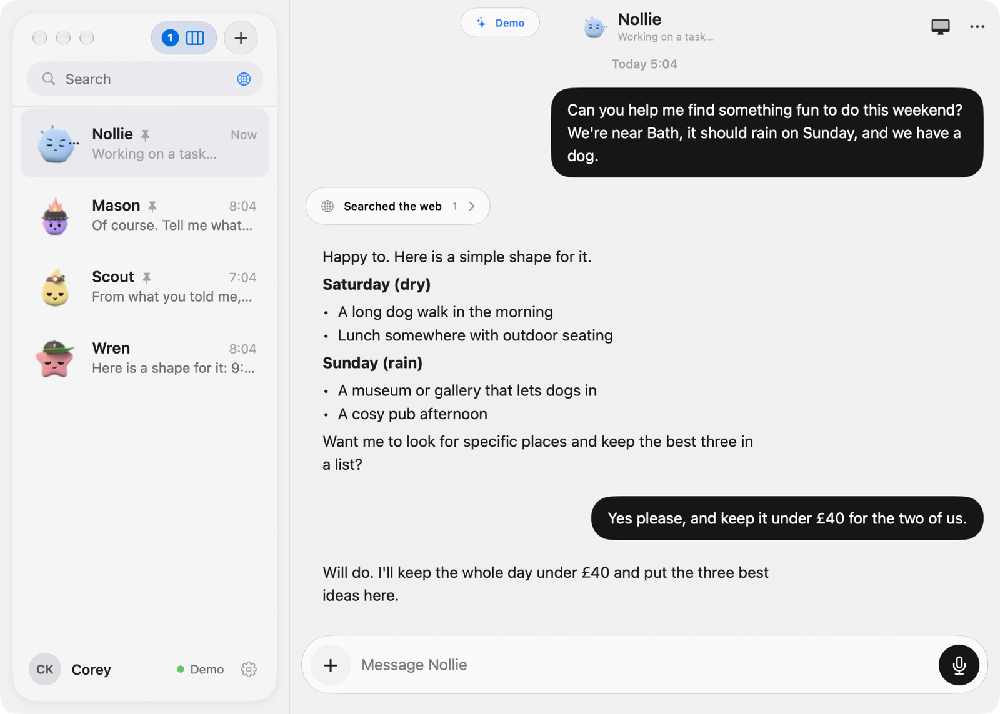

<p align="center">
  
</p>

<h1 align="center">Nollie</h1>

<p align="center">
  Your crew. Your call.<br>
  AI helpers on your Mac that wait for your yes.
</p>

<p align="center">
  <a href="https://github.com/kozarski/nollie/releases/latest"><b>Download for Mac</b></a>
  &nbsp;·&nbsp;
  <a href="https://nollie.app">nollie.app</a>
  &nbsp;·&nbsp;
  <a href="#build-it-yourself">Build it yourself</a>
</p>

<p align="center">
  <a href="https://github.com/kozarski/nollie/actions/workflows/ci.yml"></a>
  
  
</p>

> **In short:** Nollie is a free, open-source Mac and iPhone app for
> [Hermes Agent](https://github.com/NousResearch/hermes-agent). Install one app and it sets up a few AI
> helpers on your Mac that research, write, run errands on the web and keep an eye on things for you.
> Anything that matters, like sending an email, waits for your yes, on your Mac or iPhone. No accounts, no
> servers, no tracking. **Version 1.3, Apple silicon Mac on macOS 26+.**

<p align="center">
  
</p>

## What it does

| Feature | What you get |
| :--- | :--- |
| **Chats like Messages** | Typing dots while a helper works, then the whole reply, with its steps and results in the thread. |
| **Local models first** | Run a model on your Mac, or bring your own API keys or ChatGPT or Claude plan. |
| **A crew** | Each helper has its own name, look and instructions. Add more when you need them. |
| **Ask first** | Sending, buying, posting and deleting always wait for you. Fixed rules, not the model's judgement. [How it works](Docs/ask-first.md) |
| **Computers of their own** | A helper can work in its own small computer inside your Mac, away from your files. Watch it live from your phone. |
| **Stop from the Lock Screen** | While a helper is using a computer, Stop sits on your iPhone's Lock Screen. |
| **Night shift** | One card each morning: what your crew did overnight, and why each step was allowed. |
| **Papertrail** | Every connection your helpers make, and where it went. [What it can't see yet](Docs/specs/papertrail.md#what-papertrail-still-cant-see) |
| **Saved sign-ins** | A helper can log in to a site after you approve. It never sees the password. |
| **Board and schedules** | Ongoing work in one place, and "every morning, do X" just by asking. |
| **Try a demo** | Look around without setting anything up. |

## Get it

- **Mac:** the zip or DMG from the [latest release](https://github.com/kozarski/nollie/releases/latest).
  Signed and notarized by Apple, and it updates itself (always asking first).
- **iPhone and iPad:** on TestFlight now. Get the invite at [nollie.app](https://nollie.app).
- **You need:** an Apple silicon Mac on macOS 26 or later, and iOS or iPadOS 26 or later for the phone app.
  First setup downloads about 180 MB, more if you pick a local model.

## Coming Soon

- Homebrew: `brew install --cask kozarski/nollie/nollie`
- iPhone and iPad on the App Store
- Stop from anywhere, not only when your phone can reach your Mac
- Calendar, Reminders and Contacts for your helpers
- A family chat with your crew
- Talking to Nollie with your voice

## Privacy

- Your chats stay between your devices and your own Mac. There is no Nollie server.
- Your phone reaches your Mac over an encrypted link only those two can open. [Nollie Link](Docs/nollie-link.md)
- Pick an online model and your messages go to that provider under your own account. Papertrail shows when.
- Logs stay on your Mac and leave the words of your chats out. **Settings › About › Remove** takes everything away.

[Privacy policy](https://nollie.app/privacy) · [How Nollie keeps you safe](Docs/security-note.md)

## Build it yourself

You need Xcode 27. Open `Nollie.xcodeproj` and pick a scheme:

| Scheme | Builds |
| :--- | :--- |
| `Nollie` | iPhone and iPad |
| `NollieMacDirect` | The full Mac app (configuration `DirectDebug`) |
| `NollieMac` | The sandboxed Mac client |

```sh
# iPhone simulator, no signing needed
xcodebuild -project Nollie.xcodeproj -scheme Nollie -configuration Debug \
  -destination 'generic/platform=iOS Simulator' -derivedDataPath build/ios \
  CODE_SIGNING_ALLOWED=NO build

# The whole check: builds, unit and Python tests, UI flows
python3 Tools/dev/verify.py
```

The Mac app and real devices need your own signing team. `Tools/mock-gateway` is a stand-in Hermes for
trying things without your own data. More in [Development](Docs/development.md) and
[Architecture](Docs/architecture.md).

## Help

- **Bugs and questions:** [open an issue](https://github.com/kozarski/nollie/issues/new/choose). Attach the
  file from **Settings › About › Diagnostics** if you can.
- **Security:** report privately, see [SECURITY.md](SECURITY.md).
- **Say thanks:** [sponsor on GitHub](https://github.com/sponsors/kozarski). Nollie stays free either way.

## License

MIT, © 2026 Corey Kozarski. Nollie runs [Hermes Agent](https://github.com/NousResearch/hermes-agent) by Nous
Research and can use [Cua](https://github.com/trycua/cua); their notices are in [LICENSE](LICENSE). Not
affiliated with either. The Nollie characters and icon are my own artwork and aren't covered by the code
license.
